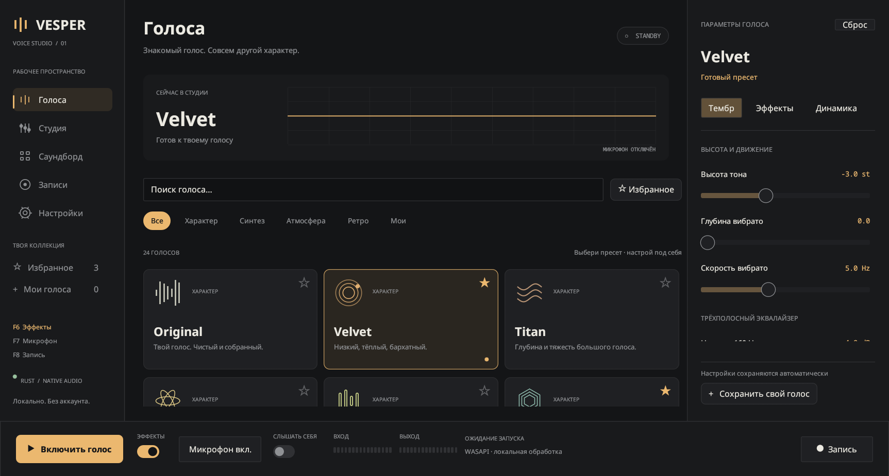

<div align="center">
  
  <br /><br />
  <a href="../../releases/latest"></a>
  
  
  <a href="LICENSE"></a>
  <br /><br />
  <strong>A voice studio you can call your own.</strong><br />
  24 voices. 26 controls. Soundboard. Recording. All on your computer.
  <br /><br />
  <a href="#get-started">Download</a> · <a href="#features">Features</a> · <a href="#why-vesper">Comparison</a> · <a href="#small-footprint-full-studio">Performance</a> · <a href="#build-from-source">Build</a>
</div>

<br />



## Free. Forever.

**VESPER will always remain a free project.** No PRO tier, subscriptions, registration, rotating daily voices or paid controls. Every built-in feature is available from the start. This is the project's commitment; released source code is available under [GNU GPL v3](LICENSE).

The interface and audio engine are written in **Rust**: a native window, local processing and direct access to Windows Audio. No Electron, embedded browser, JavaScript interface or cloud server. Libraries, Windows APIs and the external audio driver have their own licenses.

## Get started

1. Open the [latest release](../../releases/latest) and download **`Vesper-…-Setup-x64.exe`**.
2. Run Setup and accept the Windows permission prompt. **VB-CABLE is installed automatically if missing**; this option is enabled by default. An existing driver is left in place.
3. Restart Windows if the installer requests it after adding the driver.
4. Open VESPER, select your physical microphone and a voice, then press the main play button to start processing.
5. In your game, Discord or browser, select **CABLE Output** or the **Default** system microphone. An application already capturing audio may need to restart its microphone capture.

**Prefer a portable version?** Extract `Vesper-…-Portable-x64.zip` and run `Vesper.exe`. Rust and development tools are not required to run the app. Sending processed audio to other applications requires VB-CABLE; its original installer is included in `VirtualCable`.

**Interface language:** the current 1.2.0 application UI is in Russian, as shown above. This repository's main documentation and release notes are in English.

> VB-CABLE is a separate donationware driver by **VB-Audio Software**. Author: [vb-cable.com](https://www.vb-cable.com/). [Support the author and review licensing terms](https://vb-audio.com/Services/licensing.htm). Its files are distributed unchanged. VESPER being free does not override VB-Audio's terms, including those for professional use.

## Features

| Voice | Controls | Workflow |
|---|---|---|
| **24 voice presets**, from Velvet and Broadcast to Android and Arcade | **26 manual controls**, custom presets and JSON import/export | **Windows default microphone** routing with restoration of the previous device |
| Pitch, vibrato, ring modulation and bit depth | Three-band EQ, high-pass filter, gate, compressor and de-esser | **Soundboard:** 8 sounds, custom WAV files and drag-and-drop |
| Distortion, echo, reverb and dry/wet mix | Input/output gain, clip volume, buffer and monitoring | **WAV recording**, level meters, waveform and automatic settings persistence |

**F6** — effects / clean voice · **F7** — mute output · **F8** — record.<br />
**Ctrl + 1…8** — soundboard clips while the window is focused. F6–F8 work globally and can be disabled in settings.

System mode sets CABLE Output as the default Windows input for all three audio roles. Stopping, closing or encountering an audio stream error restores the previous microphone. A small watchdog process and a routing journal help recover the input after a crash.

## Why VESPER?

**Everyday voice effects should be available without a paid plan.** VESPER offers a fully accessible manual studio, offline processing and source code you can build and change yourself.

| What matters | VESPER | Voicemod FREE / PRO |
|---|---|---|
| Access to built-in voices | All 24 are always available | FREE has a limited daily selection; the full library requires PRO |
| Create and save custom voices | 26 controls, no purchase required | VoiceLab is a PRO feature |
| Account and internet connection | Not required to use VESPER | Official requirements include service connectivity and account sign-in |
| Customize the studio itself | Source and build instructions are available here | Features are determined by the vendor |
| Neural voice conversion | DSP effects only | AI voices and a much broader catalog |

Sources: [Voicemod FREE vs. PRO](https://support.voicemod.net/hc/en-us/articles/360014300760-Voicemod-Features-Free-vs-PRO), [system requirements](https://support.voicemod.net/hc/en-us/articles/5641794328594-Voicemod-s-system-requirements-Windows-macOS), [AI voices and catalog](https://www.voicemod.net/en/voice-changer/). Checked November 14, 2026.

[Clownfish](https://clownfish-translator.com/voicechanger/) is also free and supports system effects and VST. VESPER focuses on a single studio window with voice controls, visualization, a soundboard and recording. Clownfish may be a better fit if you need VST plugins or an external voice conversion client.

We have not run comparative RAM, CPU, latency or audio quality benchmarks against other products. We publish VESPER's measurements without assigning unverified resource usage to competitors. Explore the screenshot and try the app to judge its design and workflow yourself.

## Small footprint. Full studio.

| Measurement | VESPER 1.1.1 result |
|---|---:|
| Standalone EXE | **5.72 MB** |
| Private physical RAM: app + recovery process | **≈37.5 MiB** (≈39.4 MB) |
| Active system mode CPU on an i5-12450H with 12 logical processors | **≈3.6% of total CPU capacity** |
| Reduction in pure DSP processing time versus 1.1.0 | **28.43%** |
| Output samples checked before/after optimization | **3,456,000, bit-for-bit identical** |

These measurements come from a previous build of the same audio engine. They are not maximum resource guarantees or comparisons with Voicemod. Version 1.2.0 adds installation and release infrastructure; see release assets for exact current file sizes. Memory and CPU usage depend on the operating mode, window state, drivers and recording. Methodology and supporting figures are in [benchmarks.json](docs/benchmarks.json).

Effect coefficients are recalculated when settings change, with constant calculations moved out of sample processing. Waveform data is published up to 30 times per second. When idle or minimized, the UI refreshes once per second, and hotkeys wake it separately. Audio processing remains continuous.

## Things to know

- VESPER provides **DSP effects**, not a copy of a specific person's voice. Independent formant preservation and neural voice cloning are not implemented.
- Processing is mono. Pitch/vibrato can add up to approximately **43 ms** of algorithmic delay; WASAPI, drivers and the receiving application add their own latency. End-to-end latency has not been measured.
- System mode changes default input devices. An application explicitly set to a physical microphone will keep using it until you select **CABLE Output**.
- Installing VB-CABLE requires administrator privileges and may require a restart. Uninstalling VESPER preserves the shared driver.
- Release binaries do not yet have a publisher code signature. SHA-256 checksums verify file integrity but do not replace a digital signature.

Recordings and settings are stored in `%LOCALAPPDATA%/Vesper`. Custom WAV files and recordings add to disk usage; 48 kHz / mono / 16-bit PCM WAV uses approximately **5.76 MB per minute**.

## Build from source

Requirements: Windows x64, PowerShell 7.2+, [Rustup](https://rustup.rs/) and MinGW-w64 (`gcc`, `ar` and `windres` on PATH; MSYS2 MINGW64 works). The release Rust version is pinned to **1.100.0 GNU**.

```powershell
# Specify a path only if MinGW is not already on PATH.
./build.ps1 -MingwBin 'C:/msys64/mingw64/bin'

# build.ps1 selects the pinned GNU toolchain for its process.
$env:RUSTUP_TOOLCHAIN = '1.100.0-x86_64-pc-windows-gnu'
cargo fmt --check
cargo test --locked
```

Output: `dist/bin/Vesper.exe`. Build scripts contain no paths specific to the author's computer. To package Setup, the portable ZIP, sources and checksums:

```powershell
./scripts/Write-ThirdPartyNotices.ps1
./scripts/New-Release.ps1 -SkipBuild
```

The first run downloads the original VB-CABLE package and packaging tools into `.tools`, using pinned SHA-256 hashes. These downloads are excluded from Git. Official installer package signatures are verified. The Inno Setup compiler is extracted locally without a global installation.

Release output is written to `dist/release/1.2.0`. Before repackaging, archive the previous `dist/stage/1.2.0` directory: the script stops rather than mixing old and new files.

<details>
<summary><strong>Verification and release workflow</strong></summary>

- `cargo test --locked` checks DSP, the queue, WAV recording and routing recovery.
- `Vesper.exe --self-test --output-dir=diagnostics` renders and verifies all 24 voices.
- `cargo run --release --locked --example dsp_benchmark -- benchmark-results` runs a repeatable DSP benchmark.
- GitHub Actions verifies builds on push / pull request. A `v1.2.0` tag matching Cargo.toml builds Setup, portable, source and SHA-256 files, tests application installation without changing audio drivers, and creates a **draft release**.
- Secrets, tokens, recordings, user settings, `.tools`, `target` and `dist` are excluded from the source package.
- To release a new version, update Cargo.toml and `assets/app.rc`, then create and push the matching tag. The repository owner publishes the draft after verification.

For an initial publication, install [GitHub CLI](https://cli.github.com/), run `gh auth login`, then `./scripts/Publish-GitHub.ps1`. The script detects your account, creates a public **vesper-voice** repository, and pushes the source and tag. GitHub Actions prepares a draft release; final publication remains with the owner. The script uses GitHub CLI without embedded tokens.

</details>

## Freedom and licenses

VESPER code is licensed under [GNU GPL v3](LICENSE): you can study, use, modify and redistribute it under the license's terms. The commitment to stay free applies to the official project; the GPL does not itself prohibit third parties from selling copies or grant rights to third-party components.

Noto fonts use [SIL OFL 1.1](licenses/FONT-OFL.txt). Rust dependency licenses are collected in [THIRD-PARTY-NOTICES](licenses/THIRD-PARTY-NOTICES.txt). VB-CABLE is a separate VB-Audio product with its own [terms](licenses/VB-CABLE-NOTICE.txt); its original license is included in the driver package.

<div align="center">
  <br />
  <strong>Your voice. Your settings. Your studio.</strong><br />
  <sub>VESPER · Native Rust voice studio · Free forever</sub>
</div>
