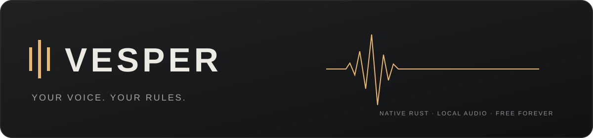

<div align="center">
  
  <br /><br />
  <a href="../../releases/latest"></a>
  
  
  <a href="LICENSE"></a>
  <br /><br />
  <strong>Голосовая студия, которая принадлежит тебе.</strong><br />
  24 голоса. 26 параметров. Саундборд. Запись. Всё на твоём компьютере.
  <br /><br />
  <a href="#начать-за-минуту">Установка</a> · <a href="#что-умеет-vesper">Возможности</a> · <a href="#почему-vesper">Сравнение</a> · <a href="#маленький-по-размеру-полноценный-в-работе">Ресурсы</a> · <a href="#сборка-из-исходников">Сборка</a>
</div>

<br />


## Бесплатно. Навсегда.

**VESPER навсегда останется бесплатным проектом.** Без PRO-версии, подписок, регистрации, ежедневной ротации доступных голосов и платной разблокировки настроек. Все встроенные возможности доступны сразу. Это обещание проекта; уже выпущенный код доступен по [GNU GPL v3](LICENSE).

Интерфейс и аудиодвижок написаны на **Rust**. Нативное окно, локальная обработка, прямой доступ к Windows Audio. Без Electron, встроенного браузера, JavaScript-интерфейса и облачного сервера. Библиотеки, Windows API и внешний драйвер имеют собственные лицензии.

## Начать за минуту

1. Открой [последний релиз](../../releases/latest) и скачай **`Vesper-…-Setup-x64.exe`**.
2. Запусти Setup и подтверди запрос Windows. **VB-CABLE устанавливается автоматически, если его ещё нет**; опция включена по умолчанию. Установленный драйвер не переустанавливается.
3. Если установщик предложит перезагрузку после добавления драйвера, перезагрузи Windows.
4. Открой VESPER, выбери физический микрофон и голос. Нажми **«Включить голос»**.
5. В игре, Discord или браузере выбери **CABLE Output** либо системный микрофон **«По умолчанию»**. Уже открытый захват микрофона может потребовать перезапуска.

**Нужна переносная версия?** Распакуй `Vesper-…-Portable-x64.zip` и запусти `Vesper.exe`. Rust и инструменты разработки для запуска не нужны. Для передачи обработанного голоса другим программам нужен VB-CABLE; его оригинальный установщик находится в `VirtualCable`.

> VB-CABLE — отдельный драйвер **VB-Audio Software**, donationware. Автор: [vb-cable.com](https://www.vb-cable.com/). [Поддержать автора и посмотреть условия](https://vb-audio.com/Services/licensing.htm). Файлы драйвера распространяются без изменений. Бесплатность VESPER не отменяет условия VB-Audio, в том числе для корпоративного использования.

## Что умеет VESPER

| Голос | Контроль | Работа |
|---|---|---|
| **24 готовых характера** — от Velvet и Broadcast до Android и Arcade | **26 ручных параметров**, свои пресеты и JSON-обмен | **Системный микрофон** Windows с возвратом прежнего устройства |
| Pitch, вибрато, кольцевая модуляция и битовая глубина | Трёхполосный EQ, фильтр высоких, гейт, компрессор и деэссер | **Саундборд:** 8 звуков, свои WAV, drag-and-drop |
| Перегруз, эхо, реверберация и dry/wet | Усиление входа/выхода, громкость клипов, буфер и мониторинг | **WAV-запись**, уровни сигнала, осциллограмма и автосохранение |

**F6** — эффекты / чистый голос · **F7** — заглушить выход · **F8** — запись.<br />
**Ctrl + 1…8** — звуки саундборда в активном окне. F6–F8 работают глобально и отключаются в настройках.

Системный режим назначает CABLE Output основным входом Windows для трёх ролей. При остановке, закрытии или ошибке аудиопотока возвращается прежний микрофон. Отдельный маленький процесс и журнал переключения помогают восстановить вход после аварии.

## Почему VESPER

**Для обычных голосовых эффектов не нужен платный тариф.** Сильная сторона VESPER — полностью доступная ручная студия, автономная работа и собственный исходный код.

| Что важно | VESPER | Voicemod FREE / PRO |
|---|---|---|
| Доступ к встроенным голосам | Все 24 постоянно доступны | В FREE — ограниченная ежедневная подборка; полная библиотека — PRO |
| Создание и сохранение своих голосов | 26 параметров, без покупки | VoiceLab — функция PRO |
| Аккаунт и интернет для работы VESPER | Не нужны | Официальные требования предусматривают подключение к сервисам и вход в аккаунт |
| Возможность доработать свою студию | Исходники и сборка доступны здесь | Набор функций определяется поставщиком |
| Нейросетевое преобразование голоса | Нет, используются DSP-эффекты | Есть AI-голоса и значительно более широкий каталог |

Источники: [Voicemod FREE и PRO](https://support.voicemod.net/hc/en-us/articles/360014300760-Voicemod-Features-Free-vs-PRO), [системные требования](https://support.voicemod.net/hc/en-us/articles/5641794328594-Voicemod-s-system-requirements-Windows-macOS), [AI и библиотека голосов](https://www.voicemod.net/en/voice-changer/). Проверено 14.11.2026.

[Clownfish](https://clownfish-translator.com/voicechanger/) тоже бесплатен и поддерживает системные эффекты и VST. В VESPER акцент на едином окне студии: голос, параметры, визуализация, саундборд и запись. Если нужны VST-плагины или внешний VC-клиент, возможности Clownfish могут подойти лучше.

Численного сравнения RAM, CPU, задержки и качества с конкурентами пока нет. Мы публикуем измерения VESPER и не приписываем другим программам непроверенный расход памяти. Дизайн и удобство можно оценить по скриншоту и попробовать самостоятельно.

## Маленький по размеру. Полноценный в работе.

| Измерение | Результат VESPER 1.1.1 |
|---|---:|
| Самостоятельный EXE | **5,72 МБ** |
| Собственная физическая ОЗУ: приложение + процесс восстановления | **≈37,5 МиБ** (≈39,4 МБ) |
| CPU работающего системного режима на i5-12450H, 12 логических процессоров | **≈3,6% общей мощности CPU** |
| Сокращение времени чистого DSP относительно 1.1.0 | **28,43%** |
| Проверенные выходные сэмплы до/после оптимизации | **3 456 000, побитно одинаковы** |

Это измерения предыдущей сборки того же аудиодвижка, а не обещание максимального расхода или сравнение с Voicemod. В 1.2.0 добавлена инфраструктура установки/релиза; точные размеры новых файлов смотри в Assets релиза. Память и CPU зависят от режима, окна, драйверов и записи. Методика и исходные числа сохранены в [benchmarks.json](docs/benchmarks.json).

Коэффициенты эффектов пересчитываются при изменении настроек; постоянные вычисления вынесены из обработки сэмплов. Осциллограмма публикуется до 30 раз в секунду. В простое и при сворачивании UI обновляется раз в секунду, а горячие клавиши будят его отдельно. Настоящий звук обрабатывается непрерывно.

## Что важно знать

- VESPER создаёт **DSP-эффекты**, а не копию голоса конкретного человека. Независимого сохранения формант и нейросетевого клонирования нет.
- Обработка моно. Pitch/vibrato могут добавить до примерно **43 ms** собственной задержки; также влияют WASAPI, драйвер и приложение получателя. Общая задержка не измерена сквозным тестом.
- Системный режим меняет входы по умолчанию. Программа, которая явно выбрала физический микрофон, продолжит его использовать до выбора **CABLE Output**.
- VB-CABLE требует прав администратора для установки. После добавления драйвера может понадобиться перезагрузка. Установщик VESPER сохраняет общий драйвер при удалении приложения.
- Сборки пока без цифровой подписи издателя. Для проверки целостности публикуются SHA-256; это не замена подписи.

Записи и настройки хранятся в `%LOCALAPPDATA%/Vesper`. Свои WAV и записи увеличивают место на диске; PCM WAV 48 kHz / mono / 16 bit — примерно **5,76 МБ в минуту**.

## Сборка из исходников

Нужны Windows x64, PowerShell 7.2+, [Rustup](https://rustup.rs/) и MinGW-w64 (`gcc`, `ar`, `windres` в PATH; подойдёт MSYS2 MINGW64). Версия Rust для релиза закреплена: **1.100.0 GNU**.

```powershell
# Путь нужен только если MinGW отсутствует в PATH.
./build.ps1 -MingwBin 'C:/msys64/mingw64/bin'

# build.ps1 выбирает закреплённый GNU toolchain для текущего процесса.
$env:RUSTUP_TOOLCHAIN = '1.100.0-x86_64-pc-windows-gnu'
cargo fmt --check
cargo test --locked
```

Результат: `dist/bin/Vesper.exe`. Скрипт не содержит путей к компьютеру автора. Чтобы собрать полный Setup, portable ZIP, исходники и контрольные суммы:

```powershell
./scripts/Write-ThirdPartyNotices.ps1
./scripts/New-Release.ps1 -SkipBuild
```

Первый запуск скачает закреплённые по SHA-256 оригинальный VB-CABLE и инструменты упаковки в `.tools`. Они исключены из Git. Подписи официальных установочных пакетов проверяются. Компилятор Inno Setup извлекается в локальную папку и не устанавливается глобально.

Полный релиз создаётся в `dist/release/1.2.0`. Для повторной упаковки перенеси прежнюю `dist/stage/1.2.0` в архив: скрипт останавливается вместо смешивания старых и новых файлов.

<details>
<summary><strong>Проверки и выпуск релиза</strong></summary>

- `cargo test --locked` проверяет DSP, очередь, WAV-запись и восстановление маршрутизации.
- `Vesper.exe --self-test --output-dir=diagnostics` рендерит и проверяет все 24 голоса.
- `cargo run --release --locked --example dsp_benchmark -- benchmark-results` запускает повторяемый тест DSP.
- GitHub Actions проверяет сборку при push / pull request. Тег `v1.2.0`, совпадающий с Cargo.toml, собирает Setup, portable, исходники и SHA-256, проверяет установку приложения без вмешательства в драйверы и создаёт **черновик релиза**.
- Секреты, токены, записи, пользовательские настройки, `.tools`, `target` и `dist` в исходники не включаются.
- Чтобы выпустить версию, обнови Cargo.toml и `assets/app.rc`, затем создай и отправь соответствующий тег. Черновик публикуется владельцем репозитория после проверки.

Для первой публикации установи [GitHub CLI](https://cli.github.com/), выполни `gh auth login`, затем `./scripts/Publish-GitHub.ps1`. Скрипт определит твой аккаунт, создаст публичный репозиторий **vesper-voice**, отправит исходники и тег. GitHub Actions подготовит черновик релиза; финальная публикация остаётся у владельца. Скрипт использует GitHub CLI без встроенных токенов.

</details>

## Свобода и лицензии

Код VESPER — [GNU GPL v3](LICENSE): можно изучать, использовать, изменять и распространять с соблюдением лицензии. Обещание бесплатности относится к официальному проекту; GPL сама по себе не запрещает третьим лицам продавать свои копии и не передаёт права на сторонние компоненты.

Шрифты Noto — [SIL OFL 1.1](licenses/FONT-OFL.txt). Лицензии Rust-библиотек собраны в [THIRD-PARTY-NOTICES](licenses/THIRD-PARTY-NOTICES.txt). VB-CABLE — отдельный продукт VB-Audio со своими [условиями](licenses/VB-CABLE-NOTICE.txt); оригинальная лицензия лежит внутри его пакета.

<div align="center">
  <br />
  <strong>Твой голос. Твои настройки. Твоя программа.</strong><br />
  <sub>VESPER · Native Rust voice studio · Free forever</sub>
</div>
